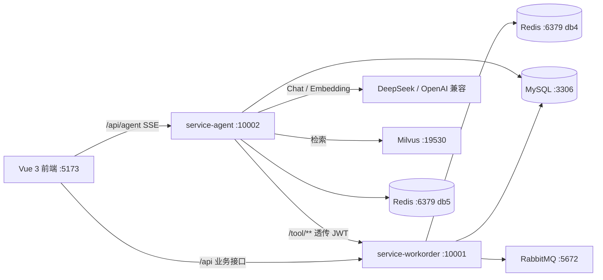
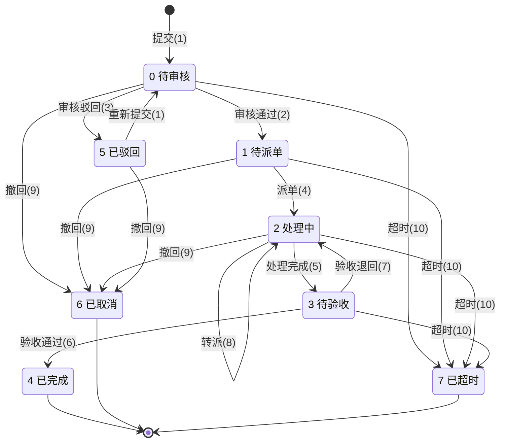
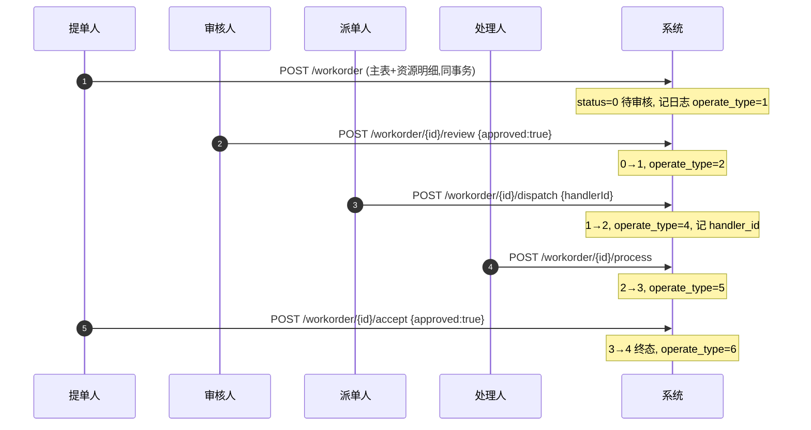

# 智能工单系统 + AI Agent 服务

一个「业务系统 + AI Agent」的完整示例：

- **项目一 `service-workorder`**：工单业务后端，负责 RBAC、数据范围、8 状态状态机、乐观锁、操作日志、缓存、MQ outbox。
- **项目二 `service-agent`**：独立的 AI Agent 服务，用 Spring AI 把项目一的 `/tool/**` 包成工具，提供自然语言查询、RAG 知识问答、工单写操作（预览 + 确认）。
- **前端 `work_order_system`**：Vue 3 + Element Plus + Pinia，包含工单管理、Agent 对话、写操作确认、知识库管理。

---

## 1. 架构



关键边界：

- **Agent 不碰业务数据库**：工单事实、权限、数据范围一律以项目一为准。
- **Agent 不发明权限**：工具可见性来自项目一 `/tool/user/info` 的 `perms`，最终写权限仍由项目一裁决。
- **Agent 自己的数据只有审计表与 Redis 短期状态**：会话记忆、perms 缓存、写确认令牌。

---

## 2. 目录

```text
backend/
  WorkOrderSystem/          # 项目一：Spring Boot 4.1.1，:10001
  SQL/                      # 数据库脚本备份
  设计理念/                 # 项目一设计文档
frontend/
  work_order_system/        # Vue 3 + Vite，:5173
Agent/
  AgentWorkOrder/           # 项目二：Spring Boot 3.5.15 + Spring AI，:10002
  设计理念/                 # M1–M5 设计文档
  接口/                     # Agent 接口文档
docker-compose.yml          # MySQL / Redis / RabbitMQ / Milvus
.env.example                # 环境变量模板（真实 .env 不提交）
scripts/load-env.ps1        # 把 .env 读入当前 PowerShell
```

---

## 3. 前置要求

| 组件 | 版本 / 说明 |
|---|---|
| JDK | 17 |
| Maven | 3.9+；项目一自带 `mvnw.cmd`，Agent 用本机 `mvn` |
| Node.js | `^22.18.0` 或 `>=24.12.0`（见前端 `package.json`） |
| Docker | Docker Desktop；需要能跑 Linux 容器 |
| 大模型 | DeepSeek 或任意 OpenAI 兼容 Chat 服务 |
| Embedding | 硅基流动 `BAAI/bge-m3` 或任意 OpenAI 兼容 embedding 服务 |

> 如果本机已经启动了 MySQL/Redis/RabbitMQ/Milvus，**不要重复启动 compose 中的同名服务**，直接复用本机实例即可。

---

## 4. 第一次启动

### 4.1 准备环境变量

```powershell
Copy-Item .env.example .env
notepad .env
```

至少填写：

- `DB_PASSWORD`：MySQL root 密码
- `REDIS_PASSWORD`：Redis 密码
- `JWT_SECRET`：项目一 JWT 签名密钥（长随机串）
- `API_KEY`：Chat 模型 Key
- `EMBEDDING_API_KEY`：Embedding Key

> `.env` 已在 `.gitignore` 中，不要提交。  
> 密钥一旦提交过，请立即到服务商后台**吊销并重新生成**，仅删除文件不算安全。

### 4.2 启动基础设施（任选其一）

**A. 使用 Docker Compose（干净环境推荐）**

```powershell
docker compose up -d
docker compose ps
```

首次启动 MySQL 会自动执行：

```text
01-schema.sql        项目一全库建表
02-data.sql          演示数据（admin/admin123 等）
03-agent-schema.sql  Agent 审计表
```

> MySQL 初始化只在数据卷为空时执行。要重新初始化：
> ```powershell
> docker compose down -v
> docker compose up -d
> ```
> `down -v` 会删除本地数据库数据，确认后再执行。

**B. 使用本机已有服务**

如果 3306 / 6379 / 5672 / 19530 已经被本机服务占用：

```powershell
Test-NetConnection localhost -Port 3306
Test-NetConnection localhost -Port 6379
Test-NetConnection localhost -Port 5672
Test-NetConnection localhost -Port 19530
```

然后手动初始化数据库（**只对空库执行**；`schema.sql` 会 DROP 表）：

```powershell
mysql -uroot -p < backend/WorkOrderSystem/src/main/resources/db/schema.sql
mysql -uroot -p < backend/WorkOrderSystem/src/main/resources/db/data.sql
mysql -uroot -p < Agent/AgentWorkOrder/src/main/resources/db/schema.sql
```

### 4.3 加载环境变量

Spring Boot 不自动读取 `.env`；在**同一个 PowerShell 会话**里执行：

```powershell
. .\scripts\load-env.ps1
```

然后从这个会话启动后端。若用 IntelliJ IDEA，可以在 Run Configuration 的 Environment variables 里填同样的键值。

---


##  健康与指标

```powershell
curl.exe http://localhost:10002/actuator/health
curl.exe http://localhost:10002/actuator/metrics/agent.sse.errors
curl.exe http://localhost:10002/actuator/metrics/agent.circuit.open
```

- `agent.circuit.open{resource="project-one"}`：项目一熔断状态；
- `agent.circuit.open{resource="llm"}`：LLM 熔断状态；
- `agent.circuit.open{resource="rag"}`：RAG 熔断状态。

---


## 关键配置

| 配置 | 默认 | 说明 |
|---|---|---|
| `agent.llm.provider` | `openai` | `mock` 可无 Key 跑通链路 |
| `agent.memory.store` | `redis` | `memory` 可回滚 |
| `agent.perm.cache-store` | `redis` | `memory` 可回滚 |
| `agent.write.token-store` | `redis` | 多实例必须 redis |
| `agent.write.max-actions-per-turn` | `1` | `0` = 只预览、不写 |
| `agent.resilience.enabled` | `true` | `false` 只保留超时/fallback |
| `agent.audit.retention-days` | `90` | 审计保留天数 |
| `agent.sse.heartbeat-seconds` | `15` | SSE 心跳间隔 |
| `agent.sse.idle-timeout-seconds` | `60` | 模型无输出超时 |

权限 / 令牌 / 记忆的 Redis key：

```text
agent:chat:memory:<userId>:<sessionId>
agent:perm:<sha256(token)>
agent:write:pending:<token>
```

---

## 10. 设计文档与评测

- `Agent/设计理念/start.md`：M1 骨架 + 只读问答
- `Agent/设计理念/M2.md`：审计 + 两层权限过滤
- `Agent/设计理念/M3.md`：RAG 知识库
- `Agent/设计理念/M4.md`：写操作对接
- `Agent/设计理念/M5.md`：Redis 持久化 + SSE 协议 + 熔断 + 审计清理
- `Agent/接口/Agent模块接口文档.md`：前端对接契约
- `eval/README.md`：Agent 质量评测、RAG 开/关对比、`/tool/**` 性能冒烟

## 11. 安全注意事项

1. **不要提交 `.env`**；模板只放占位符。
2. 如果真实 API Key / 数据库密码曾经提交过，立即吊销并重新生成；删除文件不等于从 Git 历史里消失。
3. 生产环境请替换所有演示密码与 `JWT_SECRET`。
4. `admin/admin123` 等账号只用于本地演示。
5. 对外部署时限制 `/actuator/**`、Swagger、CORS 与网关的访问范围。

---

## 附录 A：工单状态机



## 附录 B：工单全生命周期


